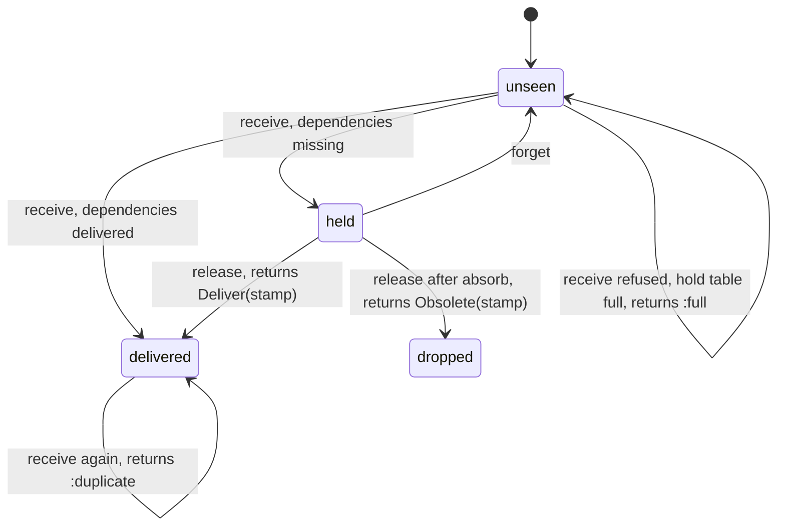
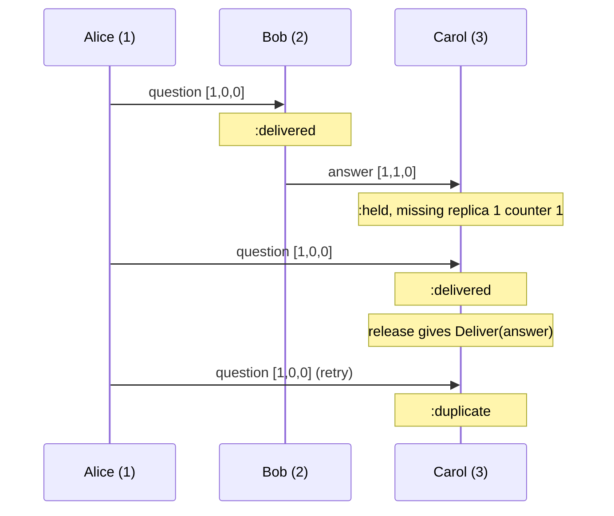

# CausalMachines

> The answer does not get to arrive before the question. 🧭

A causal-order tracker for Ruby. Every message travels with a stamp: a version vector saying what its sender had already seen. Before you act on a message, you show the tracker its stamp. The tracker tells you whether everything it depends on has been delivered here, exactly what is still missing if not, or that you already had it. Messages that arrive early wait as stamps, not payloads, and come back out the moment their dependencies land.

## Quick Start

```bash
gem 'causal_machines'
```

```ruby
members = CausalMachines::Membership.new([1, 2, 3])
tracker = CausalMachines::Causal.new(members, 3, 0)   # members, me, generation

def on_message(tracker, stamp, payload, buffer)
  case tracker.receive(stamp)
  when :delivered then apply(payload)
  when :held      then buffer[[stamp.sender, stamp.clock]] = payload
  when :duplicate, :already_held then return   # seen before, nothing changed
  else raise "tracker refused #{stamp}"        # every other symbol is a refusal
  end

  while (released = tracker.release)   # a Deliver or an Obsolete
    ready = released.stamp
    payload = buffer.delete([ready.sender, ready.clock])
    apply(payload) if released.is_a?(CausalMachines::Deliver)
  end
end

stamp = tracker.stamp   # for a message you are about to send
```

One tracker per replica. Replica ids, generations and counters are Integers; clocks are `VersionVector` values and the member list a `Membership`. The tracker keeps stamps. The payloads stay with you.

## A Message to the Resistance

So you built a chat room on three servers. Alice asks "who broke the build?" on server one. Bob, on server two, sees it and answers "you did." Server three hears from Bob first, because networks are like that, and shows Carol an accusation with no question attached.

You know the usual fixes. Sort by wall-clock timestamp, and discover that server two's clock runs four seconds ahead, so Bob now answers questions before they are asked on every screen. Switch to a Lamport counter, and get one neat total order that still cannot tell you whether Bob had *seen* Alice's message or just happened to draw a bigger number. A single number can order events. It cannot say which ones were waiting on which.

What you need is a partial order: this happened after that, and those two never knew about each other. A version vector is the smallest thing that carries it. One counter per replica, compared entry by entry. The piece you would otherwise rebuild is the delivery rule on top: a message is ready when it is its sender's next one and everything the sender had seen is already here. That rule, the list of what is missing when it fails, and a bounded waiting room for the early arrivals, is this gem.

## Chapter 1: Stardate 2026.316, the AMS Fidge

> **AMS Fidge**, NCC-4231, *Fidge*-class causality cutter.
> A reply does not clear customs before the hail it answers.

The cutter does not carry cargo and does not chase anyone. It sits on the shipping lane and reads manifests. Every dispatch lists what its sender had on board when it left. The cutter compares that list against its own log and says one of three things: cleared, already logged, or waiting on these specific dispatches from those specific ships.

On a bridge somewhere, a cadet volunteers:

```ruby
def on_message(message)
  @inbox << message
  @inbox.sort_by!(&:sent_at).each { |m| show(m) }
end
```

"That," says the cutter's navigator, "orders the fleet by whose chronometer is the most wrong."

## The Flight Plan

Each stamp the tracker is shown ends up in one of these states:



And the afternoon Bob's answer overtook Alice's question:



## How the Tracker Works

### Stamp

```ruby
members = CausalMachines::Membership.new([1, 2, 3])
alice = CausalMachines::Causal.new(members, 1, 0)
bob   = CausalMachines::Causal.new(members, 2, 0)
carol = CausalMachines::Causal.new(members, 3, 0)

question = alice.stamp
# => #<data CausalMachines::Stamp generation=0, sender=1,
#      clock=#<data CausalMachines::VersionVector counters=[1, 0, 0, 0, 0, 0, 0, 0]>>
```

`stamp` numbers your next message and hands back what to send with it. The clock has one counter per membership slot, in the order you listed the members; like the core's `VersionVector<8>`, it always holds `CausalMachines::MEMBERS` counters, the slots past your members at zero. Your own message counts as delivered to you from that moment. At counter `2**64 - 1` it answers `:exhausted` instead.

### Receive

```ruby
bob.receive(question)     # => :delivered
answer = bob.stamp        # clock counters [1, 1, 0, ...]: Bob had seen Alice's first

carol.receive(answer)     # => :held, the question is not here yet
carol.receive(answer)     # => :already_held
carol.receive(question)   # => :delivered
carol.receive(question)   # => :duplicate
```

`:delivered` means act on it now. `:held` means keep the payload somewhere; the tracker kept the stamp. `:already_held` and `:duplicate` are repeats: the tracker already has what you showed it, so the call is honoured and nothing changes. Anything else `receive` answers is a refusal. `check(stamp)` gives the same verdict (`:deliverable`, `:duplicate`, `:missing`) without changing anything, and the same refusals short of `:full`.

### Release

```ruby
carol.release   # => #<data CausalMachines::Deliver stamp=answer>
carol.release   # => nil
```

After any delivery, call `release` until it returns `nil`. `nil` means nothing is ready; `release` never refuses. Each call hands back the core's `Release`: a `Deliver(stamp)` for one held stamp whose dependencies have arrived, which now counts as delivered, or an `Obsolete(stamp)` (see Absorb below). One delivery can unblock a chain, so loop.

### Missing

```ruby
node = CausalMachines::Causal.new(CausalMachines::Membership.new([1, 2, 3]), 3, 0)
wanted = CausalMachines::Stamp.new(0, 2, CausalMachines::VersionVector.new([3, 4, 2]))

page = node.missing(wanted, 0, 2)
# page.gaps => [Gap(replica=1, from=1, through=3), Gap(replica=2, from=1, through=3)]
# page.next => 2
node.missing(wanted, page.next, 2)
# => Page(gaps=[Gap(replica=3, from=1, through=2)], next=nil)
```

`missing(stamp, cursor, limit)` lists what stands between you and that message: per replica, the inclusive run of counters not delivered here. It answers a `Page`. Start at cursor 0, take at most `limit` gaps a call (up to `CausalMachines::MEMBERS`), and pass `page.next` back until it is `nil`. A cursor is a member slot; one past the last member was never handed out, so it is refused with `:unknown_member` (after the stamp itself is judged). These are the ranges to ask your peers for.

### Absorb

```ruby
vv = ->(*counters) { CausalMachines::VersionVector.new(counters) }
node = CausalMachines::Causal.new(CausalMachines::Membership.new([1, 2, 3]), 3, 0)
late = CausalMachines::Stamp.new(0, 1, vv[2, 0, 0])
node.receive(late)            # => :held

node.absorb(0, vv[4, 0, 0])   # => :absorbed, a snapshot already covers 1..4 from replica 1
node.absorb(0, vv[3, 0, 0])   # => :already_covered, nothing new, nothing changed
node.clock                    # => VersionVector counters [4, 0, 0, ...]
node.release                  # => #<data CausalMachines::Obsolete stamp=late>
```

When you install state that already reflects a clock, `absorb` folds that clock into yours by taking the larger counter in every position, and answers `:absorbed`. When your clock already covers it, the call is an honoured repeat: `:already_covered`, nothing changed. A clock counting a slot outside the membership is refused with `:malformed`. Held stamps it covers come out of `release` as `Obsolete(stamp)`: drop their payloads, do not apply them.

### Vectors and memberships

```ruby
vv = ->(*counters) { CausalMachines::VersionVector.new(counters) }
vv[1, 2].compare(vv[1, 3])         # => :before
vv[2, 1].compare(vv[1, 2])         # => :concurrent
vv[1, 3].dominates?(vv[1, 2])      # => true
vv[2, 1].concurrent?(vv[1, 2])     # => true
vv[5, 0].merged(vv[2, 9])          # => VersionVector counters [5, 9, 0, ...]
vv[5, 0].get(0)                    # => 5
vv[5, 0].increment(1)              # => VersionVector counters [5, 1, 0, ...]
vv[2**64 - 1].increment(0)         # => :exhausted
vv[1].increment(8)                 # => :unknown_member
CausalMachines::VersionVector.new  # => all zeros, the core's VersionVector::new

members = CausalMachines::Membership.new([10, 20, 30])
members.slot(20)                   # => 1
members.replica(2)                 # => 30
members.len                        # => 3
members.admits?(vv[0, 0, 0, 1])    # => false, counts a slot outside the members
```

`VersionVector` and `Membership` mirror the core types. `VersionVector.new(counters)` is the core's `from_counters`: up to `MEMBERS` counters, the rest zero. A vector is a value, so `increment` answers a new vector (the core's new counter is its `get(slot)`) or a refusal symbol, and `merged` answers the merge. `compare` answers `:equal`, `:before`, `:after` or `:concurrent`. `Membership.new(ids)` is `Membership::from_slice`: distinct ids, at most `MEMBERS`.

### Capacity

The tracker holds 64 early stamps and up to 8 members. Past that, `receive` refuses a stamp that would have to wait with `:full`:

```ruby
node = CausalMachines::Causal.new(CausalMachines::Membership.new([1, 2, 3]), 3, 0)
from_one = ->(n) { CausalMachines::Stamp.new(0, 1, CausalMachines::VersionVector.new([n])) }
CausalMachines::CAPACITY        # => 64
CausalMachines::MEMBERS         # => 8
(2..65).each { |n| node.receive(from_one[n]) }
node.receive(from_one[66])      # => :full

node.forget(1, 65)              # => :forgotten
node.forget(1, 65)              # => :not_held, nothing changed
node.receive(from_one[66])      # => :held
```

A held stamp is never evicted to make room. `forget(sender, counter)` drops one you have decided to stop waiting for; the sender will have to send it again. It answers `:forgotten` when it dropped one and `:not_held` when none was held. Both are honoured: asking to forget a stamp that isn't held is a repeat that changes nothing. A sender outside the membership is refused with `:unknown_member`.

### Conflict

```ruby
vv = ->(*counters) { CausalMachines::VersionVector.new(counters) }
node = CausalMachines::Causal.new(CausalMachines::Membership.new([1, 2, 3]), 3, 0)
waiting = CausalMachines::Stamp.new(0, 1, vv[2, 1, 0])
node.receive(waiting)                                       # => :held
node.receive(CausalMachines::Stamp.new(0, 1, vv[1, 0, 0]))  # => :delivered

other = CausalMachines::Stamp.new(0, 1, vv[2, 0, 0])   # same sender, same counter, another clock
node.check(other)        # => :conflict
node.receive(other)      # => :conflict, though nothing it depends on is missing
node.held                # => 1, the held stamp is still there
node.forget(1, 2)        # => :forgotten, you have chosen
node.receive(other)      # => :delivered
```

Two stamps with the same sender and counter but different clocks cannot both be that sender's message, and the tracker has no way to know which one is. So it refuses the newcomer with `:conflict` whatever it would otherwise have been, ready to deliver, waiting, or already covered, and it never drops or replaces the held stamp to make the answer simpler. `check` and `missing` refuse the same way. The held stamp leaves only through `release`, or through `forget` when you decide the other one is right.

### Generations

```ruby
vv = ->(*counters) { CausalMachines::VersionVector.new(counters) }
node = CausalMachines::Causal.new(CausalMachines::Membership.new([1, 2, 3]), 3, 5)
node.receive(CausalMachines::Stamp.new(4, 1, vv[1, 0, 0]))      # => :stale_generation
node.receive(CausalMachines::Stamp.new(6, 1, vv[1, 0, 0]))      # => :future_generation
node.receive(CausalMachines::Stamp.new(5, 9, vv[1, 0, 0]))      # => :unknown_member
node.receive(CausalMachines::Stamp.new(5, 1, vv[0, 1, 0]))      # => :malformed, sender entry 0
node.receive(CausalMachines::Stamp.new(5, 1, vv[1, 0, 0, 1]))   # => :malformed, outside the members
```

### What each call can answer

| Call | Honoured | Refusals |
| --- | --- | --- |
| `stamp` | a `Stamp` | `:exhausted` |
| `check` | `:deliverable`, `:duplicate`, `:missing` | `:conflict`, `:stale_generation`, `:future_generation`, `:unknown_member`, `:malformed` |
| `receive` | `:delivered`, `:held`, `:already_held`, `:duplicate` | `:conflict`, `:full`, `:stale_generation`, `:future_generation`, `:unknown_member`, `:malformed` |
| `release` | `Deliver(stamp)`, `Obsolete(stamp)`, `nil` | none |
| `forget` | `:forgotten`, `:not_held` | `:unknown_member` |
| `missing` | a `Page` (`gaps`, `next`) | `:conflict`, `:stale_generation`, `:future_generation`, `:unknown_member` (sender, or a cursor past the last member), `:malformed` |
| `absorb` | `:absorbed`, `:already_covered` | `:stale_generation`, `:future_generation`, `:malformed` |
| `VersionVector#increment` | a new `VersionVector` | `:unknown_member`, `:exhausted` |

Each refusal is the snake_case of one core `Refusal` variant. There is no catch-all symbol. No answer records a clock: the tracker takes no time at all, so the clock rule (an answer records `now` exactly when it depends on it) has nothing to apply to. There are no scoped ids either: replica ids, generations and counters are the caller's, not issued by the tracker.

Membership is fixed for the life of a tracker. Vectors from a different set of replicas mean nothing here, so the member list carries a generation number and stamps from any other generation are refused. Changing the membership means agreeing on a new generation somewhere else and building new trackers.

## The Rules of the Cutter

- **Ids, generations and counters are Integers** in `0..2**64-1`. Floats, nil, and strings raise `TypeError`. Out of range raises `RangeError`.
- **Values are valid or do not exist.** `VersionVector`, `Membership`, `Stamp`, `Gap`, `Page`, `Deliver` and `Obsolete` validate when built, by hand or by the tracker, through the core: a wrong type (an Array where a `VersionVector` belongs, say) raises `TypeError`, a value the core would not build raises `RangeError` (more than `MEMBERS` counters or members, duplicate members, a `Gap` from 0 or running backwards, a `Page` no listing answers: a cursor past the last slot, or more gaps than slots before its cursor). Every value class is final: subclassing one raises `TypeError` and `allocate` is gone, so nothing skips that check.
- **The binding trusts no value it reads.** Sealing stops accidents, not reflection: a named subclass's constant is bound before `inherited` raises, and `Marshal.load` skips `initialize`. So every value passed in must be an instance of exactly the gem's class (a subclass raises `TypeError`), and its fields are rebuilt through the core's constructors (a forged field raises `RangeError`). A forged value never reaches the core.
- **The binding never loses work.** Every conversion happens before the core is called, and the classes are resolved once, at load. Building an answer runs Ruby code (`new`), so `stamp` and `release` decide on a copy, build the answer, and keep the copy only if the tracker is still unfrozen and unchanged: if building raises, nothing is applied (no counter spent, no stamp taken from the hold table); if it freezes the tracker, `FrozenError`; if it re-enters and changes the tracker, `RuntimeError`, and the outer call is not applied.
- **Members are distinct and include you.** Duplicate members raise `RangeError` from `Membership.new`; a local id outside the membership, or a restored clock counting a slot outside it, raises `RangeError` from `Causal.new`/`Causal.restore`.
- **Refusals don't raise.** `:full`, `:conflict`, `:stale_generation`, `:future_generation`, `:unknown_member`, `:malformed` and `:exhausted` are answers. A refused call changes nothing. `:duplicate`, `:already_held`, `:not_held` and `:already_covered` are not refusals: the call was honoured and there was nothing left to do.
- **No work is lost to an exception.** Every argument is checked and every class looked up before the tracker changes; `release` cannot hand a stamp out of the hold table and then raise.
- **Mutating calls never answer a boolean.** Every answer is a value or a symbol, so no refusal can pass for `true` in an `if`. Only the predicates `dominates?`, `concurrent?`, `admits?` and `empty?` answer `true` or `false`.
- **One stamp per sender and counter.** A second stamp with the same sender and counter but a different clock is a `:conflict` while the first is held, even when the second could be delivered on the spot. The held one is never dropped for it.
- **Frozen means frozen.** `freeze` the tracker and `stamp`, `receive`, `release`, `forget` and `absorb` raise `FrozenError`. `check` and `missing` still answer.

## What You Think You're Doing vs Reality

### You Think: "I'll sort by timestamp, then process."
### Reality: A timestamp orders messages. It does not know which ones had met.

Two messages with timestamps 5 and 6 might be a question and its answer, or two strangers typing at once. A sort treats both cases the same, and gets the first one wrong whenever a clock drifts or a packet is slow. The stamp carries what the sender had actually seen, so the tracker can hold the answer for exactly the question it needs and let unrelated messages through without waiting.

## What's Yours

The tracker lives in your process and forgets everything when the process does. Persist `clock` and rebuild with `Causal.restore` if a restart must not reuse counters or redeliver. Payloads, the buffer that holds them while their stamp waits, the network, retransmission of the gaps `missing` reports, and any agreement on who the members are: all yours. This is an initial release with an unstable API. It is the rulebook for causal order, not a broadcast runtime.

## License

MIT License. See [LICENSE.txt](LICENSE.txt) for details.

**Remember: the network will deliver the answer first. The question is whether you show it.**
