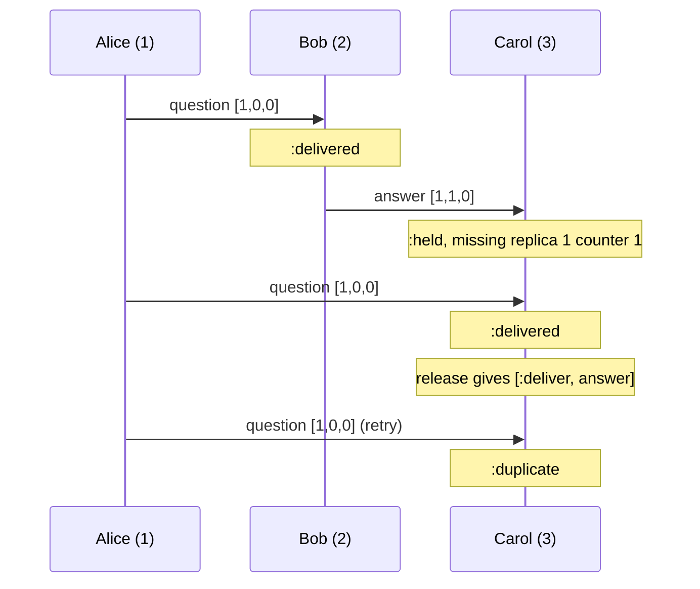

# CausalMachines

> The answer does not get to arrive before the question. 🧭

A causal-order tracker for Ruby. Every message travels with a stamp: a version vector saying what its sender had already seen. Before you act on a message, you show the tracker its stamp. The tracker tells you whether everything it depends on has been delivered here, exactly what is still missing if not, or that you already had it. Messages that arrive early wait as stamps, not payloads, and come back out the moment their dependencies land.

## Quick Start

```bash
gem 'causal_machines'
```

```ruby
tracker = CausalMachines::Tracker.new([1, 2, 3], 3, 0)   # members, me, generation

def on_message(tracker, stamp, payload, buffer)
  case tracker.receive(stamp)
  when :delivered then apply(payload)
  when :held      then buffer[[stamp.sender, stamp.clock]] = payload
  when :duplicate, :already_held then return
  else raise "tracker refused #{stamp}"
  end

  while (released = tracker.release)
    kind, ready = released
    payload = buffer.delete([ready.sender, ready.clock])
    apply(payload) if kind == :deliver
  end
end

stamp = tracker.stamp   # for a message you are about to send
```

One tracker per replica. Replica ids, generations and counters are Integers. The tracker keeps stamps. The payloads stay with you.

## A Message to the Resistance

So you built a chat room on three servers. Alice asks "who broke the build?" on server one. Bob, on server two, sees it and answers "you did." Server three hears from Bob first, because networks are like that, and shows Carol an accusation with no question attached.

You know the usual fixes. Sort by wall-clock timestamp, and discover that server two's clock runs four seconds ahead, so Bob now answers questions before they are asked on every screen. Switch to a Lamport counter, and get one neat total order that still cannot tell you whether Bob had *seen* Alice's message or just happened to draw a bigger number. A single number can order events. It cannot say which ones were waiting on which.

What you need is a partial order: this happened after that, and those two never knew about each other. A version vector is the smallest thing that carries it. One counter per replica, compared entry by entry. The piece you would otherwise rebuild is the delivery rule on top: a message is ready when it is its sender's next one and everything the sender had seen is already here. That rule, the list of what is missing when it fails, and a bounded waiting room for the early arrivals, is this gem.

## Chapter 1: Stardate 2026.316, the AMS Fidge

> **AMS Fidge**, NCC-4231, *Fidge*-class causality cutter.
> A reply does not clear customs before the hail it answers.

The cutter does not carry cargo and does not chase anyone. It sits on the shipping lane and reads manifests. Every dispatch lists what its sender had on board when it left. The cutter compares that list against its own log and says one of three things: cleared, already logged, or waiting on these specific dispatches from those specific ships.

On a bridge somewhere, a cadet volunteers:

```ruby
def on_message(message)
  @inbox << message
  @inbox.sort_by!(&:sent_at).each { |m| show(m) }
end
```

"That," says the cutter's navigator, "orders the fleet by whose chronometer is the most wrong."

## The Flight Plan

Each stamp the tracker is shown ends up in one of these states:


And the afternoon Bob's answer overtook Alice's question:



## How the Tracker Works

### Stamp

```ruby
alice = CausalMachines::Tracker.new([1, 2, 3], 1, 0)
bob   = CausalMachines::Tracker.new([1, 2, 3], 2, 0)
carol = CausalMachines::Tracker.new([1, 2, 3], 3, 0)

question = alice.stamp
# => #<data CausalMachines::Stamp generation=0, sender=1, clock=[1, 0, 0]>
```

`stamp` numbers your next message and hands back what to send with it. The clock has one counter per member, in the order you listed them. Your own message counts as delivered to you from that moment. At counter `2**64 - 1` it answers `:exhausted` instead.

### Receive

```ruby
bob.receive(question)     # => :delivered
answer = bob.stamp        # clock [1, 1, 0]: Bob had seen Alice's first

carol.receive(answer)     # => :held, the question is not here yet
carol.receive(answer)     # => :already_held
carol.receive(question)   # => :delivered
carol.receive(question)   # => :duplicate
```

`:delivered` means act on it now. `:held` means keep the payload somewhere; the tracker kept the stamp. `check(stamp)` gives the same verdict (`:deliverable`, `:duplicate`, `:missing`) without changing anything.

### Release

```ruby
carol.release   # => [:deliver, answer]
carol.release   # => nil
```

After any delivery, call `release` until it returns `nil`. Each call hands back one held stamp whose dependencies have arrived, and counts it as delivered. One delivery can unblock a chain, so loop.

### Missing

```ruby
node = CausalMachines::Tracker.new([1, 2, 3], 3, 0)
wanted = CausalMachines::Stamp.new(0, 2, [3, 4, 2])

gaps, cursor = node.missing(wanted, 0, 2)
# gaps   => [Gap(replica=1, from=1, through=3), Gap(replica=2, from=1, through=3)]
# cursor => 2
node.missing(wanted, cursor, 2)
# => [[Gap(replica=3, from=1, through=2)], nil]
```

`missing(stamp, cursor, limit)` lists what stands between you and that message: per replica, the inclusive run of counters not delivered here. Start at cursor 0, take at most `limit` gaps a call (up to `CausalMachines::MEMBERS`), and pass the returned cursor back until it is `nil`. These are the ranges to ask your peers for.

### Absorb

```ruby
node = CausalMachines::Tracker.new([1, 2, 3], 3, 0)
late = CausalMachines::Stamp.new(0, 1, [2, 0, 0])
node.receive(late)            # => :held

node.absorb(0, [4, 0, 0])     # => true, a snapshot already covers 1..4 from replica 1
node.clock                    # => [4, 0, 0]
node.release                  # => [:obsolete, late]
```

When you install state that already reflects a clock, `absorb` folds that clock into yours by taking the larger counter in every position. Held stamps it covers come out of `release` as `:obsolete`: drop their payloads, do not apply them.

### Compare and merge

```ruby
CausalMachines.compare([1, 2], [1, 3])       # => :before
CausalMachines.compare([2, 1], [1, 2])       # => :concurrent
CausalMachines.dominates?([1, 3], [1, 2])    # => true
CausalMachines.concurrent?([2, 1], [1, 2])   # => true
CausalMachines.merge([5, 0], [2, 9])         # => [5, 9]
```

Plain version-vector arithmetic on Arrays of the same length. `compare` answers `:equal`, `:before`, `:after` or `:concurrent`.

### Capacity

The tracker holds 64 early stamps and up to 8 members. Past that, `receive` says `:full` and changes nothing:

```ruby
node = CausalMachines::Tracker.new([1, 2, 3], 3, 0)
CausalMachines::CAPACITY   # => 64
CausalMachines::MEMBERS    # => 8
(2..65).each { |n| node.receive(CausalMachines::Stamp.new(0, 1, [n, 0, 0])) }
node.receive(CausalMachines::Stamp.new(0, 1, [66, 0, 0]))   # => :full

node.forget(1, 65)                                          # => true
node.receive(CausalMachines::Stamp.new(0, 1, [66, 0, 0]))   # => :held
```

A held stamp is never evicted to make room. `forget(sender, counter)` drops one you have decided to stop waiting for; the sender will have to send it again.

### Generations

```ruby
node = CausalMachines::Tracker.new([1, 2, 3], 3, 5)
node.receive(CausalMachines::Stamp.new(4, 1, [1, 0, 0]))   # => :stale_generation
node.receive(CausalMachines::Stamp.new(6, 1, [1, 0, 0]))   # => :future_generation
node.receive(CausalMachines::Stamp.new(5, 9, [1, 0, 0]))   # => :unknown_member
node.receive(CausalMachines::Stamp.new(5, 1, [0, 1, 0]))   # => :malformed
```

Membership is fixed for the life of a tracker. Vectors from a different set of replicas mean nothing here, so the member list carries a generation number and stamps from any other generation are refused. Changing the membership means agreeing on a new generation somewhere else and building new trackers.

## The Rules of the Cutter

- **Ids, generations and counters are Integers** in `0..2**64-1`. Floats, nil, and strings raise `TypeError`. Out of range raises `RangeError`, and so does a clock whose length is not the member count.
- **Members are distinct and include you.** Duplicate members or a local id outside the list raise `ArgumentError`.
- **Refusals don't raise.** `:full`, `:conflict`, `:duplicate`, `:stale_generation`, `:future_generation`, `:unknown_member`, `:malformed` and `:exhausted` are answers. A refused call changes nothing.
- **One stamp per sender and counter.** A second stamp with the same sender and counter but a different clock is a `:conflict` while the first is held.
- **Frozen means frozen.** `freeze` the tracker and `stamp`, `receive`, `release`, `forget` and `absorb` raise `FrozenError`. `check` and `missing` still answer.

## What You Think You're Doing vs Reality

### You Think: "I'll sort by timestamp, then process."
### Reality: A timestamp orders messages. It does not know which ones had met.

Two messages with timestamps 5 and 6 might be a question and its answer, or two strangers typing at once. A sort treats both cases the same, and gets the first one wrong whenever a clock drifts or a packet is slow. The stamp carries what the sender had actually seen, so the tracker can hold the answer for exactly the question it needs and let unrelated messages through without waiting.

## What's Yours

The tracker lives in your process and forgets everything when the process does. Persist `clock` and rebuild with `Tracker.restore` if a restart must not reuse counters or redeliver. Payloads, the buffer that holds them while their stamp waits, the network, retransmission of the gaps `missing` reports, and any agreement on who the members are: all yours. This is an initial release with an unstable API. It is the rulebook for causal order, not a broadcast runtime.

## License

MIT License. See [LICENSE.txt](LICENSE.txt) for details.

**Remember: the network will deliver the answer first. The question is whether you show it.**
